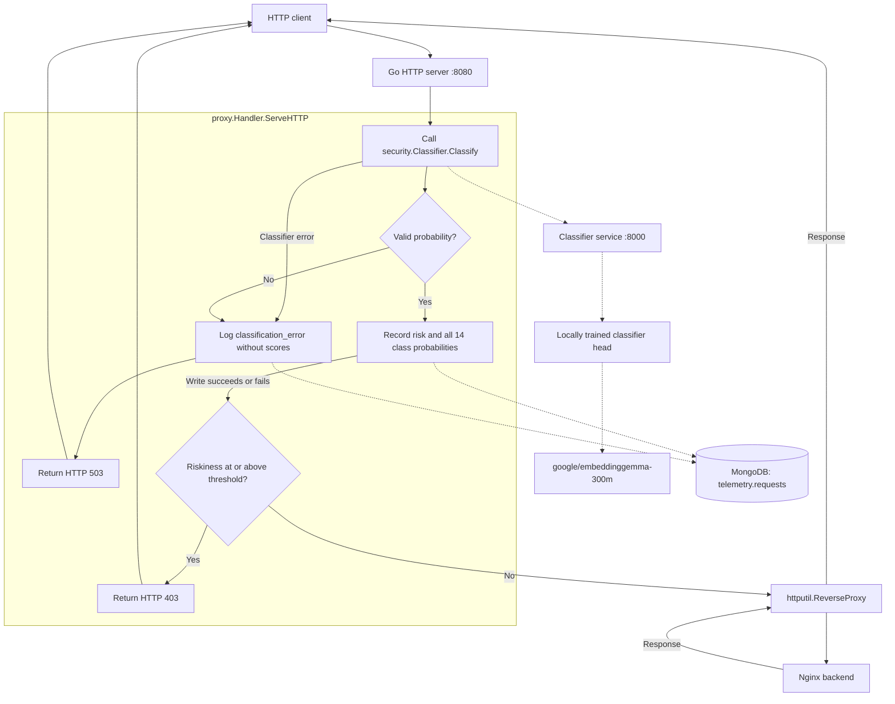

# HackRPI-Project

Start the Go reverse proxy, the threat classifier, and a simple Nginx HTTP backend.
Place your trained `model.safetensors` and `meta.json` in
`artifacts/proxy-head/head/` first. Use `HEAD_DIR=` to explicitly run the published
head instead.
The classifier backbone is gated: accept the license for
[google/embeddinggemma-300m](https://huggingface.co/google/embeddinggemma-300m),
create a read token, and export it before the first start.

```sh
export HF_TOKEN=hf_...
docker compose up --build -d
curl http://localhost:8080
```

The first start downloads EmbeddingGemma-300M into the `huggingface-cache` volume
and needs about 2 GB of RAM. Later starts reuse that volume. Compose waits until
the classifier health check passes, then starts the proxy.

Allowed requests to http://localhost:8080 show the Nginx welcome page through
the proxy. Only the proxy publishes a host port. The backend is reachable by the
proxy at `http://target-web-app:80`, and the classifier is reachable by the proxy
at `http://classifier:8000` on the Compose network.

Each request is serialized into the 20 request fields the model was trained on,
prefixed inside the classifier with `task: classification | query: `, and scored
by your trained head in `artifacts/proxy-head/head`. The comparison service
separately retains the pinned [published head](https://huggingface.co/valendra/threat-classifier-13082026).
That head returns an independent sigmoid for each of 14 CAPEC classes. The proxy
uses the highest attack-class score as `Riskiness`. When `000 - Normal` is the
strongest class, it is reported as the top label and `Riskiness` remains the
strongest attack score. Cookie is part
of the trained input. Authorization, proxy authorization, and `X-Api-Key` are
not trained fields. The classifier reads at most `CLASSIFIER_MAX_BODY` bytes
(default 256 KiB) and the proxy still forwards the complete body.

Scores at or above `RISK_THRESHOLD` (default `0.5`) return HTTP 403. These scores
are the model's sigmoid outputs. Set the threshold from traffic you have reviewed
before relying on it for blocking. Both blocked and allowed requests are logged.
Model errors and invalid scores return HTTP 503, are reported to stdout, and do
create a MongoDB record with `classification_error`, omitting scores and a
blocking decision. They never create a fabricated score.
`REVERSE_PROXY_URL` configures the backend URL; the proxy listens on port 8080.
`CLASSIFIER_URL` configures the classifier service, and `CLASSIFIER_TIMEOUT`
(default `15s`) bounds each scoring call. The classifier handles one request at
a time.

The HTTP server uses `proxy.Handler` to coordinate classification and telemetry
directly. The logger no longer wraps the reverse proxy as middleware. It records
the original request and score before the handler makes its blocking decision.



View logs with `docker compose logs -f`. Stop the services with
`docker compose down`.

Request telemetry is stored by the `telemetry` package in MongoDB, which Compose
starts automatically. MongoDB is accessible inside the Compose network and stores
its data in the `mongodb-data` volume, which survives `docker compose down`.

The proxy uses `MONGODB_URI`, `MONGODB_DATABASE` (default `telemetry`), and
`MONGODB_COLLECTION` (default `requests`). It verifies MongoDB and the classifier
before serving traffic. Each classified request is logged before the blocking decision,
with a write timeout of two seconds. A failed write is logged to stdout and the
classification decision still applies;
failed writes are not retried by the application or queued for later delivery.

Successful records include `Riskiness` (stored under the BSON field `risk`),
all 14 sigmoid scores under `attack_probabilities` using stable names such as
`normal` and `sql_injection`, the applied `threshold`, `blocked` decision, and
model identity. Failures instead include `classification_error` and omit score
and decision fields. Writes have their own timeout even after client disconnect.
All records include `simulated: false`, the real arrival timestamp in UTC,
method, URL (including query parameters), host,
remote address, protocol, and headers. Authorization, proxy authorization, cookies,
and `X-Api-Key` values are redacted. Bodies are not recorded. Other headers and
query parameters are stored as received.

Inspect recent records:

```sh
docker compose exec mongodb mongosh telemetry --quiet --eval 'db.requests.find().sort({_id:-1}).limit(5).toArray()'
```

## Local model comparison UI

Open the isolated workbench at **http://localhost:8090** after starting it:

```sh
# With HF_TOKEN already exported (first model download):
docker compose --profile comparison up -d --build comparison-lab

# Or, when the pinned models are already cached, run without network/model credentials:
COMPARISON_OFFLINE=1 docker compose --profile comparison up -d --build comparison-lab
```

The workbench starts its own classifier and the Nginx demo backend. It does not
start or reconfigure the production proxy or MongoDB. Only the workbench port is
published, bound to localhost. The UI remains usable while the classifier loads;
its availability indicator refreshes automatically.

Each comparison has three lanes:

| Lane | Model input | Head | Enforcement |
| --- | --- | --- | --- |
| A · Original | Original dataset/edited connection fields | Pinned published head | Score only; hypothetical threshold decision |
| B · Original + proxy | Current live HTTP replay fields | Same pinned published head | Actual `proxy.Handler` → Nginx, or HTTP 403 |
| C · Trained + proxy | **Identical serialized text to B** | Your exported replacement head | Same actual handler and backend |

All lanes share the frozen, pinned EmbeddingGemma backbone and classification
prompt. The original head stays pinned regardless of production `HEAD_DIR`.
The lab captures one real loopback HTTP replay connection, serializes it using
`security.SerializeRequest`, and runs both proxy lanes with that captured input.
It uses the production reverse proxy and blocking code; it does not call the
public production proxy at port 8080. Replay timestamp, source/destination
addresses, port, and protocol come from this isolated lab connection, so they can
differ from Docker ingress in production. Inspect the exact inputs in the UI.
The raw encoded path, headers, and body come from the same edited dataset row in
all lanes. Fixture protocol/connection values are used only for A. Bodies are
limited to 256 KiB to avoid silently comparing truncated content.

The six presets are actual rows from `natasa213/data-capec-multilabel`: two
normal, two SQL injection, one path traversal, and one OS command injection.
You can edit every request field or import an original dataset row as JSON.
Labels with value `1` become accepted expected top classes. Custom cases can use
`{"name":"My case","fields":{...},"expected":["66 - SQL Injection"]}`.
The preset suite is a diagnostic, not a held-out accuracy estimate. Neither
classifier failures nor a missing trained head count as an allowed request or
as a successful prediction. HTTP status is shown separately from the blocking
decision; an allowed attack path may get a normal Nginx 404 or 405.

### Load the new classifier head when training finishes

Export or copy **both** files into this directory:

```text
artifacts/proxy-head/head/model.safetensors
artifacts/proxy-head/head/meta.json
```

Then click **Load trained head**. The parent directory is mounted, so it is safe
for `head/` to be created after the services start. Loading checks the exact
14-label order, weight dimensions, and finite values, then exposes the loaded
weights' SHA-256 in the UI and exports. A failed load disables the trained lane
until a valid export is loaded. Finish writing both files before loading them.
The original baseline stays loaded. Training and embeddings are never started
or modified by the workbench.

**Export results** downloads all session comparisons, including exact inputs,
all 14 scores, model identities, threshold, expected labels, timestamps, and
actual proxy decisions/status codes. History lives only in the browser tab;
refreshing clears it. The lab does not write production request telemetry.

Stop only the workbench services with:

```sh
docker compose --profile comparison stop comparison-lab classifier-comparison
```
