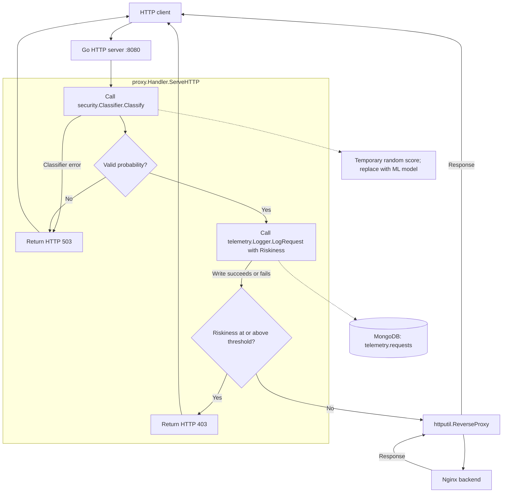

# HackRPI-Project

Start the Go reverse proxy and a simple Nginx HTTP backend:

```sh
docker compose up --build -d
curl http://localhost:8080
```

Allowed requests to http://localhost:8080 show the Nginx welcome page through
the proxy. Until the ML model is implemented, each request gets a random
`Riskiness` in [0, 1), so requests may be allowed or blocked at random.
Only the proxy publishes a host port; the backend is reachable by the proxy at
`http://target-web-app:80` on the Compose network. Compose waits for the backend
health check before starting the proxy.

The request handler runs classification, logs the request with its `Riskiness`,
then either blocks or forwards it. Implement `security.Classifier` and replace
the temporary random classifier function in `main.go` with your model. Its `Classify`
method returns the probability that the request is malicious, between 0 and 1.
Classifiers must preserve the request body if they inspect it.

Scores at or above `RISK_THRESHOLD` (default `0.5`) return HTTP 403. Both blocked
and allowed requests are logged. Model errors and invalid scores return HTTP 503,
are reported to stdout, and do not create a MongoDB record with a fabricated
score. The temporary classifier returns a random score and no error; a TODO in
`main.go` marks where to connect the real model. At the default threshold, roughly
half of requests are blocked. These temporary scores are demonstration data,
not model predictions.
`REVERSE_PROXY_URL` configures the backend URL; the proxy listens on port 8080.

The HTTP server uses `proxy.Handler` to coordinate classification and telemetry
directly. The logger no longer wraps the reverse proxy as middleware. It records
the original request and score before the handler makes its blocking decision.



View logs with `docker compose logs -f`. Stop the services with
`docker compose down`.

Request telemetry is stored by the `telemetry` package in MongoDB, which Compose
starts automatically. MongoDB is accessible inside the Compose network and stores
its data in the `mongodb-data` volume, which survives `docker compose down`.

The proxy uses `MONGODB_URI`, `MONGODB_DATABASE` (default `telemetry`), and
`MONGODB_COLLECTION` (default `requests`). It verifies MongoDB connectivity before
serving traffic. Each classified request is logged before the blocking decision,
with a write timeout of two seconds. A failed write is logged to stdout and the
classification decision still applies;
failed writes are not retried by the application or queued for later delivery.

Records include `Riskiness` (stored under the BSON field `risk`), a UTC timestamp,
method, URL (including query parameters), host,
remote address, protocol, and headers. Authorization, proxy authorization, cookies,
and `X-Api-Key` values are redacted. Bodies are not recorded. Other headers and
query parameters are stored as received.

Inspect recent records:

```sh
docker compose exec mongodb mongosh telemetry --quiet --eval 'db.requests.find().sort({_id:-1}).limit(5).toArray()'
```
