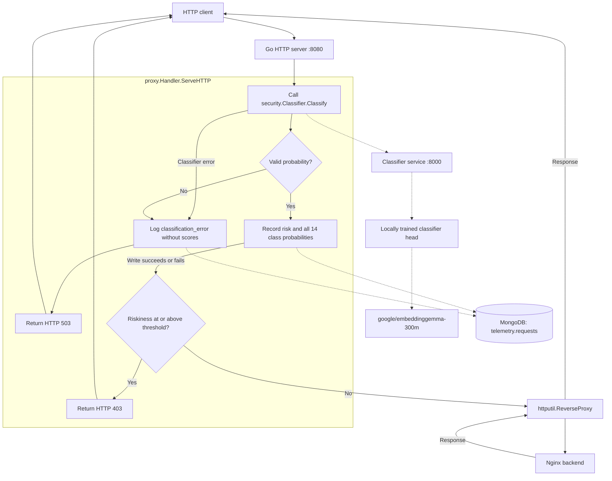

# HackRPI-Project

Start the Go reverse proxy, the threat classifier, and a simple Nginx HTTP backend.
Place your trained `model.safetensors` and `meta.json` in
`artifacts/proxy-head/head/` first for the default trained mode. Set
`CLASSIFIER_MODE=original_2020` to use the pinned published head with only the
model-input timestamp year normalized to 2020; that mode needs no trained export.
The classifier backbone is gated: accept the license for
[google/embeddinggemma-300m](https://huggingface.co/google/embeddinggemma-300m),
create a read token, and export it before the first start.

```sh
export HF_TOKEN=hf_...
docker compose up --build -d
curl http://localhost:8080
```

The first start downloads EmbeddingGemma-300M into the `huggingface-cache` volume
and needs about 2 GB of RAM. Later starts reuse that volume. Both heads share the
same frozen embedding model; head selection does not retrain or reload it. Compose waits until
the classifier health check passes, then starts the proxy.

Allowed requests to http://localhost:8080 show the Nginx welcome page through
the proxy. Traffic Lab is restored at http://localhost:8081. The proxy publishes
these two ports; the backend is reachable by the
proxy at `http://target-web-app:80`, and the classifier is reachable by the proxy
at `http://classifier:8000` on the Compose network.

Each request is serialized into the 20 request fields the model was trained on,
prefixed inside the classifier with `task: classification | query: `, and scored
by the head selected with `CLASSIFIER_MODE`. The default is your trained head in
`artifacts/proxy-head/head`. The comparison service
separately retains the pinned [published head](https://huggingface.co/valendra/threat-classifier-13082026).
That head returns an independent sigmoid for each of 14 CAPEC classes. The proxy
uses the highest attack-class score as `Riskiness`. When `000 - Normal` is the
strongest class, it is reported as the top label and `Riskiness` remains the
strongest attack score. Cookie is part
of the trained input. Authorization, proxy authorization, and `X-Api-Key` are
not trained fields. The classifier reads at most `CLASSIFIER_MAX_BODY` bytes
(default 256 KiB) and the proxy still forwards the complete body.

Scores at or above `RISK_THRESHOLD` (default `0.5`) return HTTP 403. These scores
are the model's sigmoid outputs. Set the threshold from traffic you have reviewed
before relying on it for blocking. Both blocked and allowed requests are logged.
Model errors and invalid scores return HTTP 503, are reported to stdout, and do
create a MongoDB record with `classification_error`, omitting scores and a
blocking decision. They never create a fabricated score.
`REVERSE_PROXY_URL` configures the backend URL; the proxy listens on port 8080.
`CLASSIFIER_URL` configures the classifier service, and `CLASSIFIER_TIMEOUT`
(default `15s`) bounds each scoring call. The classifier handles one request at
a time.

## Choose the model

After building the updated services with the startup command above, select either
mode by recreating only the proxy process with its new environment setting:

```sh
# Your trained head; preserve the actual year in model input.
CLASSIFIER_MODE=trained docker compose up -d --no-deps proxy

# Published head; change only the model-input timestamp year to 2020.
CLASSIFIER_MODE=original_2020 docker compose up -d --no-deps proxy
```

Both modes keep the highest attack score as risk and the same `RISK_THRESHOLD`
(default 0.5). Both preserve live source/destination addresses, the actual request,
and the true timestamp used by telemetry. Dates inside a URL, header, or body are
never rewritten. The 2020 option is the published Hugging Face head with the
shared pinned EmbeddingGemma runtime; it does not restore the old Ollama runtime
or its former `1 - Normal` risk policy.

The Python service keeps the published head as its baseline and loads the local
export separately. The Go client selects `/classify-trained` or `/classify` and
performs year normalization only for `original_2020`. Trained mode fails readiness
when its export is unavailable; it does not silently fall back to the original.
Weights and datasets stay ignored by Git. A teammate who selects trained mode
must obtain both export files separately.

The workbench at http://localhost:8090 has the same two choices in **Model for
comparison C**. This dropdown changes isolated comparisons, not the production
proxy setting. It records the selected mode and exact input in each exported
result. Neither comparison mode writes to MongoDB.

## Traffic Lab

The partner's Traffic Lab control panel is restored at http://localhost:8081
when the updated proxy starts. It keeps the existing dispatch rate, malicious
mix, attack categories, reference replay, pause/resume, stop, and session reset.
**Classifier model** selects **Trained model · current dates** or **Original
model · dates set to 2020** for simulations only. Changing it does not change
the live proxy's `CLASSIFIER_MODE`. Each activity row identifies the chosen model.

New synthetic samples use dates in the current year. Reference replay preserves
the captured 2020 inputs. In original-2020 mode the classifier client normalizes
only the serialized timestamp year; actual submitted timestamps remain unchanged
in telemetry. Both models use the proxy's configured `RISK_THRESHOLD`.

`POST /submit` still accepts the partner's telemetry-shaped request or original
training-shaped JSON. It also accepts an optional `model_mode` (`trained` or
`original_2020`); omission uses the configured default. The response retains
`riskiness`, all 14 named `attack_probabilities`, `threshold`, `blocked`, `accepted`,
and `simulated`, and adds model identity. Successful evaluations return 201 after
the existing logger succeeds; classifier and persistence errors return 503.
Simulated requests are never forwarded to a backend or their synthetic IPs.
The existing MongoDB logger, database/collection names, and volume are retained.

For database-free testing, first start the workbench's classifier using the
comparison-profile startup command below, then run the standalone preview:

```sh
docker build --build-arg APP_PATH=./cmd/traffic-lab -t hackrpi-traffic-lab-preview .
docker run --rm --name hackrpi-traffic-lab-preview --network vivian-demo_default \
  -p 127.0.0.1:8082:8082 -e LAB_ADDR=:8082 \
  -e CLASSIFIER_URL=http://classifier-comparison:8000 hackrpi-traffic-lab-preview
# http://localhost:8082 — browser-session results only, no MongoDB connection
```

This uses the existing `classifier-comparison` service, which keeps the published
baseline and trained export loaded. For a native classifier already reachable on
the host, `CLASSIFIER_URL=http://127.0.0.1:8000 go run ./cmd/traffic-lab` also works.
The preview's `/config` reports `persistence: session`, the page states that
MongoDB is disabled, and returned results have `saved: false`.

Checks that do not access a database:

```sh
go test . ./cmd/... ./security ./comparison ./proxy ./telemetry ./simulation
node --test simulation/web/generator.test.mjs
```

The optional MongoDB integration test stays disabled unless `MONGODB_TEST_URI`
is explicitly supplied.

The HTTP server uses `proxy.Handler` to coordinate classification and telemetry
directly. The logger no longer wraps the reverse proxy as middleware. It records
the original request and score before the handler makes its blocking decision.



View logs with `docker compose logs -f`. Stop the services with
`docker compose down`.

Request telemetry is stored by the `telemetry` package in MongoDB, which Compose
starts automatically. MongoDB is accessible inside the Compose network and stores
its data in the `mongodb-data` volume, which survives `docker compose down`.

The proxy uses `MONGODB_URI`, `MONGODB_DATABASE` (default `telemetry`), and
`MONGODB_COLLECTION` (default `requests`). It verifies MongoDB and the classifier
before serving traffic. Each classified request is logged before the blocking decision,
with a write timeout of two seconds. A failed write is logged to stdout and the
classification decision still applies;
failed writes are not retried by the application or queued for later delivery.

Successful records include `Riskiness` (stored under the BSON field `risk`),
all 14 sigmoid scores under `attack_probabilities` using stable names such as
`normal` and `sql_injection`, the applied `threshold`, `blocked` decision, and
model identity. Failures instead include `classification_error` and omit score
and decision fields. Writes have their own timeout even after client disconnect.
All records include `simulated: false`, the real arrival timestamp in UTC,
method, URL (including query parameters), host,
remote address, protocol, and headers. Authorization, proxy authorization, cookies,
and `X-Api-Key` values are redacted. Bodies are not recorded. Other headers and
query parameters are stored as received.

Inspect recent records:

```sh
docker compose exec mongodb mongosh telemetry --quiet --eval 'db.requests.find().sort({_id:-1}).limit(5).toArray()'
```

## Local model comparison UI

Open the isolated workbench at **http://localhost:8090** after starting it:

```sh
# With HF_TOKEN already exported (first model download):
docker compose --profile comparison up -d --build comparison-lab

# Or, when the pinned models are already cached, run without network/model credentials:
COMPARISON_OFFLINE=1 docker compose --profile comparison up -d --build comparison-lab
```

The workbench starts its own classifier and the Nginx demo backend. It does not
start or reconfigure the production proxy or MongoDB. Only the workbench port is
published, bound to localhost. The UI remains usable while the classifier loads;
its availability indicator refreshes automatically.

Each comparison has three lanes:

| Lane | Model input | Head | Enforcement |
| --- | --- | --- | --- |
| A · Original | Original dataset/edited connection fields | Pinned published head | Score only; hypothetical threshold decision |
| B · Original + proxy | Current live HTTP replay fields | Same pinned published head | Actual `proxy.Handler` → Nginx, or HTTP 403 |
| C · Selected model | Live input, or the same input with only its timestamp year changed to 2020 | Trained head or pinned published head | Same actual handler and backend |

All lanes share the frozen, pinned EmbeddingGemma backbone and classification
prompt. The original head stays pinned regardless of production `HEAD_DIR`.
The lab captures one real loopback HTTP replay connection, serializes it using
`security.SerializeRequest`, and runs both proxy lanes with that captured input.
The dropdown selects the head for C and changes the model-input year only in
original-2020 mode. It uses the production reverse proxy and blocking code; it does not call the
public production proxy at port 8080. Replay timestamp, source/destination
addresses, port, and protocol come from this isolated lab connection, so they can
differ from Docker ingress in production. Inspect the exact inputs in the UI.
The raw encoded path, headers, and body come from the same edited dataset row in
all lanes. Fixture protocol/connection values are used only for A. Bodies are
limited to 256 KiB to avoid silently comparing truncated content.

The six presets are actual rows from `natasa213/data-capec-multilabel`: two
normal, two SQL injection, one path traversal, and one OS command injection.
You can edit every request field or import an original dataset row as JSON.
Labels with value `1` become accepted expected top classes. Custom cases can use
`{"name":"My case","fields":{...},"expected":["66 - SQL Injection"]}`.
The preset suite is a diagnostic, not a held-out accuracy estimate. Neither
classifier failures nor a missing trained head count as an allowed request or
as a successful prediction. HTTP status is shown separately from the blocking
decision; an allowed attack path may get a normal Nginx 404 or 405.

### Load the new classifier head when training finishes

Export or copy **both** files into this directory:

```text
artifacts/proxy-head/head/model.safetensors
artifacts/proxy-head/head/meta.json
```

Then click **Load trained head**. The parent directory is mounted, so it is safe
for `head/` to be created after the services start. Loading checks the exact
14-label order, weight dimensions, and finite values, then exposes the loaded
weights' SHA-256 in the UI and exports. A failed load disables the trained lane
until a valid export is loaded. Finish writing both files before loading them.
The original baseline stays loaded. Training and embeddings are never started
or modified by the workbench.

**Export results** downloads all session comparisons, including exact inputs,
all 14 scores, model identities, threshold, expected labels, timestamps, and
actual proxy decisions/status codes. History lives only in the browser tab;
refreshing clears it. The lab does not write production request telemetry.

Stop only the workbench services with:

```sh
docker compose --profile comparison stop comparison-lab classifier-comparison
```


## Paired holdout evaluation

`scripts/evaluate_heads.py` cleans the external holdout, scores both heads on a
shared frozen embedding per request, and calculates accuracy and blocking metrics.
It never trains either head or selects a threshold from the holdout.

The completed run is in `artifacts/proxy-head/evaluation/`. The cleaned dataset is
`data/proxy_shaped_holdout_clean.csv`. Input CSVs and model weights are preserved.
The run verifies the source hashes against the exported Colab `run_identity.json`.

Cleaning excludes identical request content in the full 30,000-row retraining
pool, ignoring only timestamps and connection IPs/ports. It also deduplicates the
holdout and removes conflicting-label groups. The initial 500 rows become 332;
a stricter 267-row subset also excludes matching method/path/body regardless of
headers. These are two predefined scopes, not outcome-selected samples.

`cmd/freeze-evaluation` reconstructs the fixed proxy-shaped connection fields and
passes every request through `security.SerializeRequest`. It uses the CSV's frozen
2026 timestamps, source/destination metadata and headers, not the lab listener's
random port. Bare targets get the leading slash required by live proxy requests.
No response fields, labels or annotations enter the text. Both heads receive
identical vectors from the same pinned backbone, prompt and encoding settings.
This measures classifier behavior on proxy-shaped requests; it is not a traffic
load or end-to-end network benchmark.

The inspected outputs are `cleaning.json`, `exclusions.json`, `frozen_inputs.jsonl`,
`runtime.json`, `predictions.jsonl`, `predictions.csv`, `per_class.csv`, `summary.json`,
and `validation.json`. All are ignored local artifacts. The prediction file keeps
all 14 probabilities and exact input/embedding hashes for every case. Per-class
precision/recall/F1 and binary blocking use 0.5 for both heads; top-label accuracy
accepts any positively annotated ground-truth label. Macro F1 is reported both
across the 12 supported classes and across all 14 with zero-division set to zero.
Classes without positives remain untested. Paired accuracy intervals use 5,000
row-level bootstrap resamples with seed 42; related attack templates can remain
correlated. Model initialization originally used the published head, whose own
historical split membership is unknown, so this is evidence of adaptation to the
proxy format, not proof of entirely unseen attack-family generalization.

To reproduce with the existing comparison container and cached Go build image:

```sh
python3 scripts/evaluate_heads.py prepare
docker run --rm -i --network none -v "$PWD:/app:ro" -w /app vivian-demo-comparison-check go run ./cmd/freeze-evaluation < artifacts/proxy-head/evaluation/cases.jsonl > artifacts/proxy-head/evaluation/frozen_inputs.jsonl
docker cp scripts/evaluate_heads.py vivian-demo-classifier-comparison-1:/tmp/evaluate_heads.py
docker cp artifacts/proxy-head/evaluation/frozen_inputs.jsonl vivian-demo-classifier-comparison-1:/tmp/paired-proxy-inputs.jsonl
docker exec vivian-demo-classifier-comparison-1 python /tmp/evaluate_heads.py score --inputs /tmp/paired-proxy-inputs.jsonl --output /tmp/paired-proxy-evaluation --batch-size 32
docker cp vivian-demo-classifier-comparison-1:/tmp/paired-proxy-evaluation/. artifacts/proxy-head/evaluation/
python3 scripts/evaluate_heads.py analyze
```

If the cached Go build image is unavailable, create it with
`docker build --target build -t vivian-demo-comparison-check .` first. Verify metrics
independently and check representative batch predictions against the live
`/classify` and `/classify-trained` APIs before interpreting a rerun. The completed
run was cross-checked with scikit-learn; live API differences were below 0.000003.


For the matched original-format baseline, run
`python3 scripts/prepare_original_baseline.py`. It recovers the exact same 332
source row IDs from the original CSV, verifies unchanged labels and payloads,
and restores original source timestamps, connection fields and empty Accept
values. These inputs are serialized directly in the author's 20-field order.
The completed original-format predictions, metrics, validation, and combined
three-way comparison are in `artifacts/proxy-head/evaluation-original-format/`.
This is a format baseline; source rows may have been seen by the published head.


## XGBoost challenger at validation-matched false-positive rates

The completed experimental head and records are in
`artifacts/proxy-head/xgboost-comparison/`. They do not replace the production
classifier or the comparison UI's neural head.

`scripts/compare_xgboost_head.py` reuses the downloaded Colab cache under
`artifacts/proxy-head/cached-colab/`. The downloaded progress files verify every
Parquet split hash and completion count; cached labels are checked against row
order, and the complete 30,000-row pool matches the recorded input CSV exactly.
The original pinned trainer fits on train.npy and selects the neural checkpoint
on val.npy; it does not use test.npy in fitting or checkpoint selection.

The challenger fits the same 24,000 training vectors. Its 13 nonconstant binary
XGBoost models use a single predeclared configuration: version 3.1.3, CPU hist,
max depth 3, at most 300 iterations, learning rate 0.05, clipped positive weights
1–10 as in the neural loss, and early stopping on log loss. CAPEC 248 has no
positive fitting examples and uses a constant-zero output. No final-test model
or hyperparameter search was performed.

Request groups use method, normalized path, and body. Removing fitting/test
group matches leaves 1,596 rows from the old validation split for tree iteration
selection. The old internal test split is repurposed as separate threshold
validation: after removing fitting, original model-selection, and external-test
group matches, 1,603 rows remain (408 normal, 1,195 attacks). Both thresholds are
selected using benign validation scores only, to realize the largest common
false-positive count within the predeclared 1% budget. They flag exactly 4/408
normal validation requests each (0.9804%). Thresholds are locked before external
holdout scoring; they are not adjusted to match test-set false-positive rates.

The primary external test is the strict 267-case subset, with 201 attacks and 66
normal requests and zero request-group overlap with the cached 30,000-row pool.
The earlier 332-case set is retained as a descriptive secondary check because it
has header-distinct request-group matches with the original training pool.
Only the 332 external evaluation vectors were regenerated for caching; all
30,000 training/selection/calibration embeddings were reused. Each head receives
the identical vector for a given case. The existing neural probabilities match
the prior evaluation within the recorded numerical tolerance.

Run the experiment inside an isolated environment with xgboost==3.1.3 and
pyarrow==26.0.1 installed, using the existing classifier image's numpy, torch,
safetensors and scikit-learn dependencies:

```sh
python scripts/compare_xgboost_head.py train --out /tmp/xgb-head-comparison --target-fpr 0.01
python scripts/compare_xgboost_head.py evaluate --out /tmp/xgb-head-comparison
python scripts/export_xgboost_results.py
```

The evaluate step expects the frozen holdout cache at
`artifacts/proxy-head/evaluation/embeddings.npy`. The completed run includes
native `.ubj` models, `models.json`, `training.json`, `thresholds.json`,
`validation_predictions.npz`, `test_predictions.npz`, `comparison.json`,
`validation.json`, `operating_points.csv`, and `test_predictions.csv` with all 14
probabilities per head. Saved-model reloads reproduce predictions identically.
Threshold tests cover ties and prove that changing validation attack scores
cannot affect the benign-only matching rule. Scores, confusion counts and
accuracies were independently checked using scikit-learn.

The observed attack-recall gain is modest and uncertain: nine additional attacks
caught on the 201-attack primary test, with a paired bootstrap 95% interval that
includes zero. Zero observed false blocks among 66 normal test requests does not
establish a zero or 1% production false-positive rate. Several classes remain
rare or absent; original published-head pretraining membership is unknown. The
same benchmark has already been inspected during model development, so a fresh
independent dataset is needed before a production decision.
