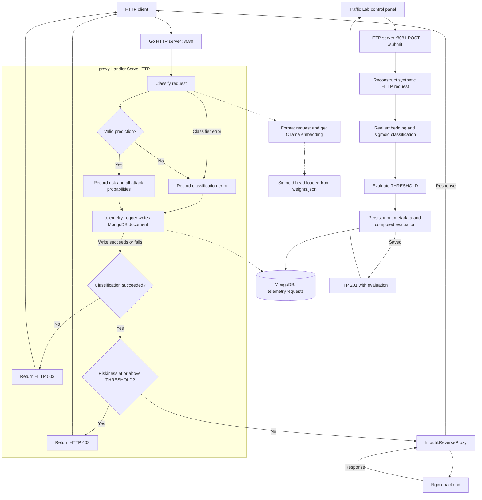

# HackRPI-Project

Start the Go reverse proxy and a simple Nginx HTTP backend:

```sh
docker compose up --build -d
curl http://localhost:8080
```

To run the Go proxy locally with local MongoDB and Ollama, export the connection
settings in the same terminal as `go run`. Use your backend's actual URL:

```sh
export REVERSE_PROXY_URL=http://127.0.0.1:3000
export MONGODB_URI=mongodb://127.0.0.1:27017
export MONGODB_DATABASE=telemetry
export MONGODB_COLLECTION=requests
export OLLAMA_HOST=http://127.0.0.1:11434
export OLLAMA_MODEL=embeddinggemma:300m
go run .
```

Go does not automatically load `.env`. Docker service names such as `mongodb`
and `target-web-app` resolve inside the Compose network, so use reachable local
URLs when running Go on the host. Restart the local Go process after code changes.

Allowed requests to http://localhost:8080 show the Nginx welcome page through
the proxy. Requests are classified using the trained sigmoid head in
`classifier/weights.json` and EmbeddingGemma embeddings from Ollama.
The proxy exposes ports 8080 (traffic) and 8081 (simulations); the backend is
reachable at `http://target-web-app:80` inside Compose. Compose waits for the
backend and MongoDB health checks and the Ollama model download before starting Go.

The separate simulation server starts with the same Go process on port 8081.
Open http://localhost:8081/ for the Traffic Lab control panel. It generates normal
and attack-shaped telemetry and sends it through the real Ollama embedding and
sigmoid classifier. Nothing is forwarded to the backend or the simulated IPs.
Adjust request rate (1–100/sec), malicious mix (0–100%), attack-category checkboxes,
and batch size (up to 100,000), or enable continuous generation. Pause/resume,
stop, and reset controls manage the current session.

**New samples** is the default generation mode. Each request gets newly generated
content: paths, parameters, payload grammar, form values, methods, browser/header
combinations, 2020 timestamps, ports, and source IPs. SQL injection generation
varies boolean, UNION, timing, and comment-obfuscated forms across GET queries and
POST bodies; traversal varies separators, depth and target files; OS command
injection varies operators and command forms. Normal requests also vary paths,
methods and benign form bodies. The training serializer and encoding conventions
stay fixed. This is synthetic generalization testing, not a replay of known inputs.

**Reference replay** is a separate format diagnostic that explicitly replays the
supplied normal, SQL injection, traversal, and OS command examples. Categories
without supplied fixtures are disabled in this mode; captured metadata is retained.
Replay scores measure those known examples and must not be treated as evidence of
unseen-sample performance. MongoDB records `generation_mode` as `generated` or
`examples`. Generated samples differ from the supplied fixtures, but without the
full training corpus we cannot guarantee that every generated pattern was absent
from the original dataset.

The live log shows only source IP, intended classification, and accepted/rejected
decision. Totals cover the full session; the log retains the latest 500 responses.
Acceptance/rejection percentages use completed model decisions, excluding pending
requests and errors. A separate error counter and message report classifier or
database failures. Up to eight evaluations run concurrently, so the actual rate
can be lower than the dispatch target when the model is busy.

Submit a JSON object containing the request fields of `RequestTelemetry`:

```sh
curl http://localhost:8081/submit \
  -H 'Content-Type: application/json' \
  -d '{"method":"GET","url":"/products?id=1%27%20OR%201%3D1","host":"app.example.test","remote_addr":"45.79.23.14:51000","protocol":"HTTP/1.1","headers":{"User-Agent":["Traffic Lab"]},"intended_classification":"sql_injection"}'
```

`method`, `url`, and `remote_addr` are required. Optional fields are `timestamp`,
`host`, `protocol`, `headers` (arrays of strings), `body`, `destination_addr`, and
`intended_classification`, plus the optional `generation_mode` annotation
(`generated` or `examples`). Body is classifier input and is not saved. The intended
label is saved as a test annotation and is never passed to the model.
Source addresses may be IPv4/IPv6 with an optional port; `destination_addr` is
an IP and port for the synthetic target. It is used as model input and saved in
MongoDB. The control server's own address is excluded from synthetic model input.
Public-format IPs are the default for geolocation testing. The optional private
training-network profile varies source IPs in `172.26.0.*` instead; it does not
replay one captured client. New samples vary destination metadata and ports as well.
Public IPs are outside the captured private-network distribution and can affect
predictions; no physical location is guaranteed. Exact replay always retains the
fixture's captured addresses and disables the source-profile selector.
Server-owned fields (`risk`, `attack_probabilities`, `blocked`, and similar
outputs) are not accepted. The real classifier computes risk and all scores;
blocking uses the same `THRESHOLD` as proxy traffic.
The response is HTTP 201 after a successful MongoDB insert, including
`riskiness`, `attack_probabilities`, `threshold`, `blocked`, and `simulated`.
A blocked simulation also returns 201 because the evaluation was saved.
Classification failures are also saved and return 503 without an acceptance
decision. Persistence failures return 503. Inputs are limited to 128 KiB; the
server returns 429 when all eight simulation slots are occupied.

Simulations go to the same MongoDB collection with `simulated: true`, `threshold`,
and `blocked` for completed predictions, plus `intended_classification` and the
submitted source metadata. Proxy records have `simulated: false`. For example, query
`db.requests.find({simulated: true})` to inspect only simulations.

The request handler runs classification, logs the request with its `Riskiness`,
then either blocks or forwards it. `classifier.RequestClassifier` formats the
original request, obtains a 768-dimensional embedding, and runs
`SigmoidClassifier.ClassifyAttack`. Riskiness is `1 - Normal`, the complement of
the Normal-class score. The 14 sigmoid outputs are independent and are not summed.
The request body is restored before forwarding.

Both endpoints capture the request timestamp (the submitted timestamp for
simulations, or the arrival time for proxy traffic). Telemetry-shaped JSON uses
RFC3339; model input uses the captured Apache format, for example
`18/Jul/2020:05:26:36 +0200`. The year is normalized to 2020. Month, day, clock time,
and offset are preserved; subsecond digits are omitted from model text to match
the training examples. February 29 remains valid. MongoDB retains the original
timestamp; forwarded request headers and bodies are unchanged.

The serializer now matches the supplied training archive's `REQUEST_FIELDS`:
exactly 20 request fields in the original order, empty values skipped, and no
response fields or extra headers. Its fingerprint `9059e530f7e4` and query prefix
match the embedding-cache metadata in `classifier/weights.json`. The loader
rejects weights with a conflicting declared serializer or prompt.
`Authorization`, forwarding headers, `Content-Length`, and `Transfer-Encoding`
are not serialized because they were absent from the training schema. A scenario
that changes only these headers cannot be distinguished by this trained input
contract; retain such cases as coverage tests rather than expected predictions.

The generator bundles the six supplied JSON examples unchanged for explicit replay
and regression checks. They do not supply the default generator's request content.
REF badges appear only in Reference replay mode. In that mode, normal traffic uses
`normal.json` and `normal_v2.json`, and supported attacks use their supplied fixtures.
New-sample attack categories are dynamically generated approximations, not manually
labeled held-out traffic. The training archive notes that CAPEC 248
Command Injection has only one training row and no validation/test rows. Its
`command_injection.json` is actually CAPEC 88 OS Command Injection. No trained
year-range rejection appears in the supplied code; date formatting and data
distribution can affect predictions, but the year alone does not prove a crash cause.

`POST /submit` also accepts unchanged `examples_request/*.json` training documents,
using `src_ip`, `dst_ip`, and `request_*` keys and their captured timestamp format:

```sh
curl http://localhost:8081/submit -H 'Content-Type: application/json' \
  --data-binary @classifier/embeddings/testdata/training_examples/sql_injection.json
```

Bare targets such as `test.php` and `search.php?...` remain bare; URL and form
payloads are never unescaped, cleaned, or re-encoded. Tests compare all six
fixtures byte-for-byte with text generated by the supplied Python serializer.

Scores at or above `proxy.THRESHOLD` (currently `0.5`, defined in
`proxy/handler.go`) return HTTP 403. Both blocked and allowed requests are logged.
Model errors and invalid scores also create a MongoDB record with
`classification_error`, then return HTTP 503. Those failure records omit `risk`
and `attack_probabilities`. Malformed or incompatible weights cause startup to fail.
`REVERSE_PROXY_URL` configures the backend URL; the proxy listens on port 8080.

The HTTP server uses `proxy.Handler` to coordinate classification and telemetry
directly. The logger no longer wraps the reverse proxy as middleware. It records
the original request and score before the handler makes its blocking decision.



For local Ollama, download the training-compatible embedding model before
sending proxy requests:

```sh
ollama pull embeddinggemma:300m
```

See the [EmbeddingGemma model page](https://ollama.com/library/embeddinggemma)
for Ollama requirements. Compose runs its own Ollama server at
`http://ollama:11434` and an `ollama-pull` service that fetches the selected model.
It exposes Ollama on `127.0.0.1:11435` by default to avoid conflicting with a
native Ollama on port 11434; set `OLLAMA_PORT` to change the published port.
If running Go locally against Compose Ollama, use
`export OLLAMA_HOST=http://127.0.0.1:11435`.
For local Go with native Ollama, use `http://127.0.0.1:11434`.
`OLLAMA_MODEL` defaults to `embeddinggemma:300m`. Use the exact tag installed in
Ollama; installing `:300m` does not necessarily install a `:latest` alias.
The embedding request uses the training
prompt prefix `task: classification | query: ` and a 30-second timeout.
`CLASSIFIER_WEIGHTS` defaults to `./classifier/weights.json`; the Docker image
includes that file at `/app/classifier/weights.json`. A custom weights file must
be accessible inside the container and match the embedding model and label order.

Ollama model files live in the named `ollama-data` volume at `/root/.ollama`.
After the first download, subsequent starts and image rebuilds reuse those files.
The pull service may check for updates, but existing model blobs are reused.
Normal `docker compose down` preserves the cache. `docker compose down -v` or
explicit volume deletion removes it. Native Ollama's cache is separate from this
container volume, so the first container download is still needed.

View logs with `docker compose logs -f`. Stop the services with
`docker compose down`.

Request telemetry is stored by the `telemetry` package in MongoDB, which Compose
starts automatically. MongoDB is accessible inside the Compose network and stores
its data in the `mongodb-data` volume, which survives `docker compose down`.

The proxy uses `MONGODB_URI`, `MONGODB_DATABASE` (default `telemetry`), and
`MONGODB_COLLECTION` (default `requests`). It verifies MongoDB connectivity before
serving traffic. Every handled request is logged after the classification attempt,
including failed predictions, before the blocking decision,
with a write timeout of two seconds. A failed write is logged to stdout and the
classification decision still applies;
failed writes are not retried by the application or queued for later delivery.

Successful records include `Riskiness` (stored under the BSON field `risk`) and
all 14 named scores under `attack_probabilities`, including `normal`,
`sql_injection`, and `path_traversal`. All records include a UTC timestamp,
method, URL (including query parameters), host,
remote address, protocol, and headers. Authorization, proxy authorization, cookies,
and `X-Api-Key` values are redacted. Bodies are not recorded. Other headers and
query parameters are stored as received.

Inspect recent records in local MongoDB (if `mongosh` is installed):

```sh
mongosh mongodb://127.0.0.1:27017/telemetry --eval 'db.requests.find().sort({_id:-1}).limit(5).toArray()'
```

For Compose MongoDB:

```sh
docker compose exec mongodb mongosh telemetry --quiet --eval 'db.requests.find().sort({_id:-1}).limit(5).toArray()'
```

Run the optional MongoDB integration test against a local instance:

```sh
MONGODB_TEST_URI=mongodb://127.0.0.1:27017 go test ./telemetry -run TestMongoRequestPersistence -v
```

The test creates and removes a unique collection in `telemetry_integration_test`.

Validate the generator templates with `node --test simulation/web/generator.test.mjs`.
