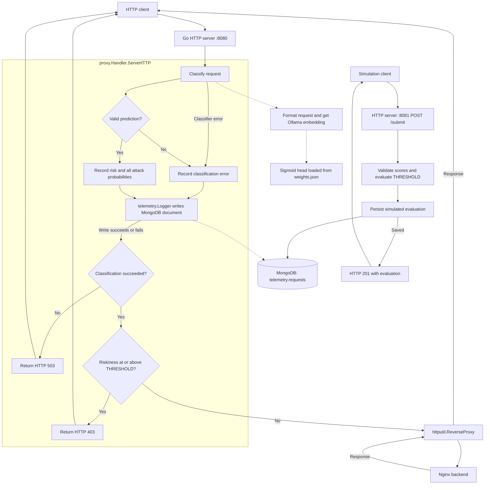

# HackRPI-Project

Start the Go reverse proxy and a simple Nginx HTTP backend:

```sh
docker compose up --build -d
curl http://localhost:8080
```

To run the Go proxy locally with local MongoDB and Ollama, export the connection
settings in the same terminal as `go run`. Use your backend's actual URL:

```sh
export REVERSE_PROXY_URL=http://127.0.0.1:3000
export MONGODB_URI=mongodb://127.0.0.1:27017
export MONGODB_DATABASE=telemetry
export MONGODB_COLLECTION=requests
export OLLAMA_HOST=http://127.0.0.1:11434
export OLLAMA_MODEL=embeddinggemma:300m
go run .
```

Go does not automatically load `.env`. Docker service names such as `mongodb`
and `target-web-app` resolve inside the Compose network, so use reachable local
URLs when running Go on the host. Restart the local Go process after code changes.

Allowed requests to http://localhost:8080 show the Nginx welcome page through
the proxy. Requests are classified using the trained sigmoid head in
`classifier/weights.json` and EmbeddingGemma embeddings from Ollama.
The proxy exposes ports 8080 (traffic) and 8081 (simulations); the backend is
reachable at `http://target-web-app:80` inside Compose. Compose waits for the
backend and MongoDB health checks and the Ollama model download before starting Go.

The separate simulation server starts with the same Go process on port 8081.
Submit an `AttackProbabilities` JSON object to evaluate a case without invoking
Ollama or forwarding to the backend:

```sh
curl http://localhost:8081/submit \
  -H 'Content-Type: application/json' \
  -d '{"normal":0.2,"sql_injection":0.85,"path_traversal":0.1}'
```

`normal` is required; omitted attack scores default to zero. Unknown fields,
null values, malformed JSON, and probabilities outside [0, 1] are rejected.
Riskiness is `1 - normal`; blocking uses the same `THRESHOLD` as real requests.
The response is HTTP 201 after a successful MongoDB insert, including
`riskiness`, `attack_probabilities`, `threshold`, `blocked`, and `simulated`.
A blocked simulation also returns 201 because the evaluation was saved.
Persistence failures return 503. Inputs are limited to 16 KiB.

Simulations go to the same MongoDB collection with `simulated: true`, `threshold`,
and `blocked`. Proxy records have `simulated: false`. For example, query
`db.requests.find({simulated: true})` to inspect only simulations.

The request handler runs classification, logs the request with its `Riskiness`,
then either blocks or forwards it. `classifier.RequestClassifier` formats the
original request, obtains a 768-dimensional embedding, and runs
`SigmoidClassifier.ClassifyAttack`. Riskiness is `1 - Normal`, the complement of
the Normal-class score. The 14 sigmoid outputs are independent and are not summed.
The request body is restored before forwarding.

Scores at or above `proxy.THRESHOLD` (currently `0.5`, defined in
`proxy/handler.go`) return HTTP 403. Both blocked and allowed requests are logged.
Model errors and invalid scores also create a MongoDB record with
`classification_error`, then return HTTP 503. Those failure records omit `risk`
and `attack_probabilities`. Malformed or incompatible weights cause startup to fail.
`REVERSE_PROXY_URL` configures the backend URL; the proxy listens on port 8080.

The HTTP server uses `proxy.Handler` to coordinate classification and telemetry
directly. The logger no longer wraps the reverse proxy as middleware. It records
the original request and score before the handler makes its blocking decision.



For local Ollama, download the training-compatible embedding model before
sending proxy requests:

```sh
ollama pull embeddinggemma:300m
```

See the [EmbeddingGemma model page](https://ollama.com/library/embeddinggemma)
for Ollama requirements. Compose runs its own Ollama server at
`http://ollama:11434` and an `ollama-pull` service that fetches the selected model.
It exposes Ollama on `127.0.0.1:11435` by default to avoid conflicting with a
native Ollama on port 11434; set `OLLAMA_PORT` to change the published port.
If running Go locally against Compose Ollama, use
`export OLLAMA_HOST=http://127.0.0.1:11435`.
For local Go with native Ollama, use `http://127.0.0.1:11434`.
`OLLAMA_MODEL` defaults to `embeddinggemma:300m`. Use the exact tag installed in
Ollama; installing `:300m` does not necessarily install a `:latest` alias.
The embedding request uses the training
prompt prefix `task: classification | query: ` and a 30-second timeout.
`CLASSIFIER_WEIGHTS` defaults to `./classifier/weights.json`; the Docker image
includes that file at `/app/classifier/weights.json`. A custom weights file must
be accessible inside the container and match the embedding model and label order.

Ollama model files live in the named `ollama-data` volume at `/root/.ollama`.
After the first download, subsequent starts and image rebuilds reuse those files.
The pull service may check for updates, but existing model blobs are reused.
Normal `docker compose down` preserves the cache. `docker compose down -v` or
explicit volume deletion removes it. Native Ollama's cache is separate from this
container volume, so the first container download is still needed.

View logs with `docker compose logs -f`. Stop the services with
`docker compose down`.

Request telemetry is stored by the `telemetry` package in MongoDB, which Compose
starts automatically. MongoDB is accessible inside the Compose network and stores
its data in the `mongodb-data` volume, which survives `docker compose down`.

The proxy uses `MONGODB_URI`, `MONGODB_DATABASE` (default `telemetry`), and
`MONGODB_COLLECTION` (default `requests`). It verifies MongoDB connectivity before
serving traffic. Every handled request is logged after the classification attempt,
including failed predictions, before the blocking decision,
with a write timeout of two seconds. A failed write is logged to stdout and the
classification decision still applies;
failed writes are not retried by the application or queued for later delivery.

Successful records include `Riskiness` (stored under the BSON field `risk`) and
all 14 named scores under `attack_probabilities`, including `normal`,
`sql_injection`, and `path_traversal`. All records include a UTC timestamp,
method, URL (including query parameters), host,
remote address, protocol, and headers. Authorization, proxy authorization, cookies,
and `X-Api-Key` values are redacted. Bodies are not recorded. Other headers and
query parameters are stored as received.

Inspect recent records in local MongoDB (if `mongosh` is installed):

```sh
mongosh mongodb://127.0.0.1:27017/telemetry --eval 'db.requests.find().sort({_id:-1}).limit(5).toArray()'
```

For Compose MongoDB:

```sh
docker compose exec mongodb mongosh telemetry --quiet --eval 'db.requests.find().sort({_id:-1}).limit(5).toArray()'
```

Run the optional MongoDB integration test against a local instance:

```sh
MONGODB_TEST_URI=mongodb://127.0.0.1:27017 go test ./telemetry -run TestMongoRequestPersistence -v
```

The test creates and removes a unique collection in `telemetry_integration_test`.
